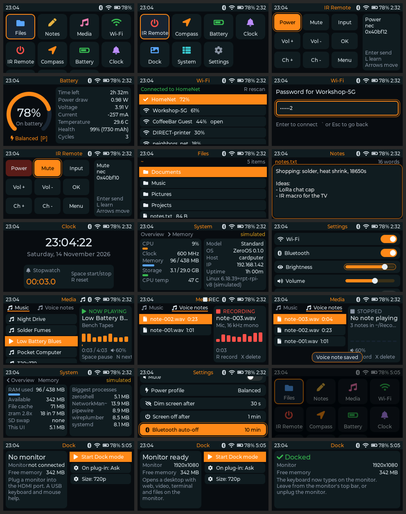

# ZeroOS for the Cardputer Zero

A custom OS for the [M5Stack Cardputer Zero](https://docs.m5stack.com/en/CardputerZero), the pocket
computer built on a Raspberry Pi CM0 (4x Cortex-A53, 512 MB RAM, 320x170 screen, 46-key keyboard).

ZeroOS is a lean Debian (trixie, arm64) image with its own keyboard-driven home screen, **ZeroShell**,
and one hardware layer that covers every part of the board: battery gauge, motion sensors, IR,
radios, audio, camera, real-time clock, key LEDs and the expansion ports.



*Every screen above is rendered by CI from the real UI code at 320x170, shown at 2x.*

## What's here (Phase 0)

| Part | Status |
| --- | --- |
| `shell/` ZeroShell: status bar, launcher, 10 apps, toasts, keyboard navigation | Working in the simulator |
| `shell/src/hal/` hardware layer: simulated (PC) and Linux (device) | Linux side written, not yet tested on hardware |
| `image/` image builder on M5's open pi-gen, pinned kernel and drivers | Built in CI on every image change |
| `.github/workflows/` CI: simulator, screenshots, arm64 build, browser build, full SD image | Ready |

Apps: **Files**, **Notes**, **Media** (music player + voice notes), **Wi-Fi**, **IR Remote** (send + learn), **Compass** (with spirit level),
**Battery** (time left, power draw, power profile), **Clock** (with stopwatch), **Dock** (desktop with web
browser, video, terminal and files on an HDMI monitor), **System** monitor (CPU and
where the memory goes), **Settings** (Wi-Fi, Bluetooth, brightness, volume, mute, power profile, screen dimming
and screen-off, Bluetooth auto-off, restart, shut down).

The screen dims after 30 s idle and turns off after 1 minute on battery; the first key only wakes it.

## Try it on a PC

```sh
sudo apt install cmake g++ libsdl2-dev
cmake -S shell -B build/sim -DZS_BACKEND=sim
cmake --build build/sim -j
./build/sim/zeroshell            # 3x window; --zoom 4 for bigger
```

Keys: arrows move, **Enter** opens, **Esc** or **`** goes back, letters jump to an app on the home screen.
Inside apps: **R** rescans Wi-Fi, **L** learns an IR code **Space** pauses music or runs the stopwatch, **N** skips a track, **R** records a voice note. Notes save when you leave.

Or build the browser version (same code, WebAssembly, one HTML file with on-screen keys):

```sh
source /path/to/emsdk/emsdk_env.sh
web/build.sh build/zeroos-simulator.html
```

Render all screens to PNG (what CI does):

```sh
cmake -S shell -B build/headless -DZS_BACKEND=headless && cmake --build build/headless -j
shell/tools/screenshots.sh build/headless/zeroshell build/screenshots
```

## Build for the device

```sh
sudo apt install g++-aarch64-linux-gnu
cmake -S shell -B build/device -DZS_BACKEND=device -DCMAKE_TOOLCHAIN_FILE=$PWD/cmake/aarch64-linux-gnu.cmake
cmake --build build/device -j
image/build.sh build/device/zeroshell        # needs Docker; 1-2 hours
```

Or run the **Build image** workflow from the Actions tab. To try ZeroShell on the stock M5 image
first, copy `build/device/zeroshell` over, stop the stock launcher
(`systemctl --user stop APPLaunch` or the system service), and run it.

## Docs

- [docs/ARCHITECTURE.md](docs/ARCHITECTURE.md): how the layers fit together
- [docs/HARDWARE.md](docs/HARDWARE.md): every chip, how Linux exposes it, known issues and our fixes
- [docs/ROADMAP.md](docs/ROADMAP.md): phases and what's next
- [docs/DOCK.md](docs/DOCK.md): Dock mode, the desktop on an HDMI monitor
- [docs/PERFORMANCE.md](docs/PERFORMANCE.md): memory and battery tuning, measurements, and `zeroos-measure`

## License

MIT. Builds on [LVGL](https://lvgl.io) (MIT), M5Stack's [pi-gen fork](https://github.com/CardputerZero/pi-gen)
(BSD-3) and [board drivers](https://github.com/m5stack/m5stack-linux-dtoverlays).
