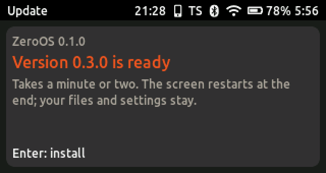
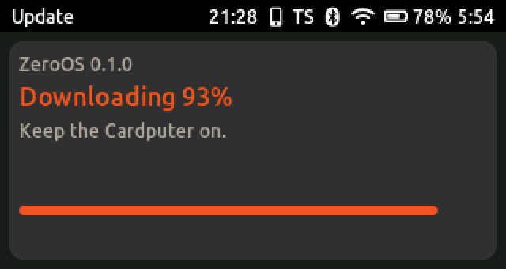
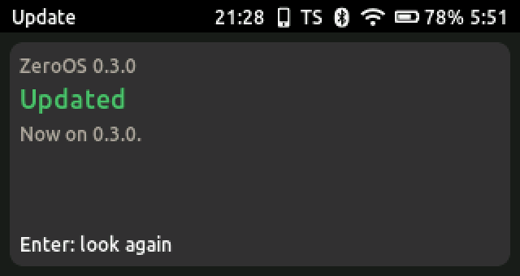

# Updating

ZeroOS updates itself over the network. No SD card re-flash, and it does not
matter how the Cardputer is online: Wi-Fi, the built-in Ethernet port, a
tethered phone or Tailscale. A PC on the same network can also push a build
straight to it.





## On the device

Open **Update** (or **Settings > Software update**). It looks for a newer
version at once. If there is one, **Enter** installs it: download, install,
and the home screen restarts on the new version. A minute or two in all.

- It won't start under 20% battery unless the Cardputer is plugged in.
- Your files, settings, Wi-Fi networks and sign-ins are not touched.
- Nothing checks in the background (that would cost battery). It looks when
  you open the app.

From a terminal or over SSH, the same thing:

```sh
sudo zeroos-update check
sudo zeroos-update install
sudo zeroos-update rollback      # back to the version before the last update
zeroos-update status
```

## From a PC, over Ethernet or Wi-Fi

For trying a build that is not a release yet. The PC and the Cardputer need
to reach each other: both on the same router or switch (Ethernet or Wi-Fi),
or both on Tailscale.

```sh
image/package.sh build/device/zeroshell      # makes build/update/zeroos_<version>_arm64.deb
tools/push-update.sh cardputer.local         # sends the newest package and installs it
```

`push-update.sh` takes any `[user@]host` and, as a second argument, any
package: one from a release, or the `zeroos-package` artifact that CI builds
for every pull request. It copies the package over SSH and runs
`zeroos-update install-file` there, so the same checks and the same rollback
apply.

A Cardputer flashed before updates existed has no `zeroos-update` yet.
`push-update.sh` notices, installs the package directly that once, and from
then on the device can update itself.

**(measure)** An Ethernet cable straight from PC to Cardputer, with no router,
should work through `cardputer.local` (both ends give themselves link-local
addresses). Not tried on the real unit yet.

## Publishing an update

Push a tag:

```sh
git tag v0.2.0
git push origin v0.2.0
```

The **Release** workflow builds ZeroShell for arm64, makes the package and
publishes a GitHub release with two files: `zeroos_0.2.0_arm64.deb` and
`zeroos-update.manifest`. Devices look at the newest release, so they see it
the next time someone opens **Update**. The tag is the version.

Builds between releases get versions such as `0.2.0+3.gabc1234` (three commits
after v0.2.0), which count as newer than 0.2.0 and older than 0.2.1
(`image/version.sh`).

## How it works

| Part | Job |
| --- | --- |
| `image/stage-zeroos/payload.sh` | The list of every file ZeroOS owns: ZeroShell, its services, scripts and settings. |
| `image/package.sh` | Packs that list into one Debian package, `zeroos`, and writes the manifest (version, file name, SHA-256, size). |
| Image build | Installs the very same package, so a flashed card and an updated one hold the same files. A copy stays on the card as the first version to roll back to. |
| `/usr/bin/zeroos-update` | On the device, as root: reads the manifest, compares versions with `dpkg`, downloads, checks the SHA-256, installs. |
| `zeroos-update.service`, `zeroos-update-check.service` | How ZeroShell (which runs as `pi`) starts the two jobs; a polkit rule allows it. Progress goes to `/run/zeroos/update.status`. |
| `/etc/zeroos/update.conf` | Where to look. `UPDATE_URL` is the GitHub releases of this repository by default. Your edits survive updates. |

**If the new version is broken.** After installing, `zeroos-update` restarts
ZeroShell and watches it for 10 seconds. If it does not stay up, the previous
package is put back, ZeroShell restarts on it and the app says **Update
undone**. The last two packages are kept in `/var/lib/zeroos/update/`
(`current.deb`, `previous.deb`), which is also what `rollback` uses.

**Your own update server.** Any web server that holds the two files from
`build/update/` will do, for a device with no route to GitHub:

```sh
cd build/update && python3 -m http.server 8000
# on the Cardputer, in /etc/zeroos/update.conf:
#   UPDATE_URL=http://192.168.1.20:8000
```

## What an update does not change

An update replaces ZeroOS's own files. It does not touch:

- **Debian packages** (the kernel, drivers, Chromium, Tailscale...). Those
  update the Debian way: `sudo apt update && sudo apt full-upgrade`. The
  kernel is pinned by the image; a new kernel means a new image.
- **Boot settings** (`config.txt`, `cmdline.txt`) and the initramfs.
- A release that needs a new Debian package says so in its notes; until
  then the feature that needs it reports that the tool is missing.

For those, flash a new image from the **Build image** workflow.

## Trust

The download comes over HTTPS from GitHub and must match the SHA-256 in the
manifest, which catches a damaged or cut-off download. The manifest comes
from the same place as the package, so this does not protect against someone
who controls the release page or, with a plain `http://` `UPDATE_URL`, the
network in between. Signing the manifest with a key kept off GitHub is the
next step if that matters.

## Not yet tested on hardware

- The whole path on a real Cardputer: download speed, how long ZeroShell is
  away during the restart **(measure)**.
- An update while Dock mode, the Terminal or the camera has the screen.
- The direct Ethernet cable, as above.

`image/tests/update-test.sh` covers the logic on a PC with stand-ins for
`dpkg -i` and `systemctl`: finding an update, refusing a bad checksum or an
odd manifest, installing, rolling back by hand, and rolling back a version
that keeps crashing. CI runs it on every pull request.
